# Davi Gama

**Software Engineer · Coimbra, Portugal**

Desenvolvo websites, plataformas e APIs, ligando as necessidades do negócio à experiência de utilização e à implementação.

[Contacto](mailto:davi.torres00pro@gmail.com) · [LinkedIn](https://www.linkedin.com/in/davinasser/) · [GitHub](https://github.com/DaviGama08)

## Portfólio

[01 · Interfaces em alta resolução](portfolio/interfaces/README.md) · [02 · Casos de estudo e qualificações](portfolio/02_Casos_de_Estudo.pdf) · [03 · Arquiteturas funcionais](portfolio/03_Arquiteturas.pdf) · [04 · Vistas técnicas](portfolio/04_Arquiteturas_Tecnicas.pdf)

Interfaces das aplicações originais, com capturas nativas em 4K e WebP sem perdas. Os dados de demonstração estão identificados em cada projeto. A revisão de código e de branches foi realizada em outubro de 2026; referências por confirmar são assinaladas no caso de estudo.

## Projetos profissionais

Trabalho para clientes, produtos independentes e ferramentas de engenharia.

### Skevia · Agendamento multi-tenant

**Disponibilidade, serviços e confirmação de marcações numa plataforma para negócios de serviços.**

A plataforma permite que cada negócio apresente a sua marca e opere a própria agenda. O Ícaro’s Barbershop, em Coimbra, é um caso aplicado, com catálogo de serviços, pacotes e marcação online.

Interface React original da main. A apresentação do Ícaro usa dados públicos do cliente; marcações e backoffice usam uma organização fictícia de demonstração.

Casos de uso, interface e backend

- Encontrar disponibilidade e selecionar serviços ou pacotes compatíveis com o horário.
- Escolher o profissional, rever o pedido e consultar o estado de confirmação.
- Gerir a agenda e as marcações, mantendo catálogo, equipa e horários.
- Personalizar o website do negócio e acompanhar os relatórios operacionais.

**Interface:** Website personalizado do negócio e marcação orientada pela disponibilidade. O cliente escolhe horário, serviços ou pacotes, profissional e dados de contacto. A confirmação distingue pedido pendente de marcação confirmada. O backoffice reúne agenda, marcações, catálogo, equipa, horários, clientes, relatórios, imagens e editor do site.

**Backend e dados:** API Java e Spring Boot para catálogo, disponibilidade, marcações e operações do negócio, com PostgreSQL e migrações. Um renderer React partilhado mantém a apresentação pública consistente com a prévia no editor.

**Tecnologias:** Java, Spring Boot, React, TypeScript, PostgreSQL

Diagrama de arquitetura · componentes e fluxos

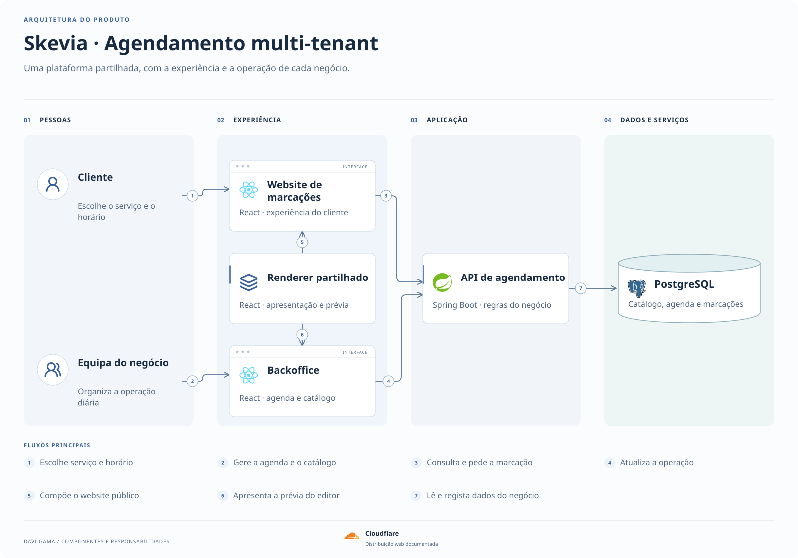

[SVG vetorial](architecture/multi-tenant.svg) · [PNG em alta resolução](architecture/multi-tenant.png)

Vista técnica · camadas, contratos e padrões

Contratos tipados ligam duas experiências React aos módulos de negócio e aos adaptadores de infraestrutura.

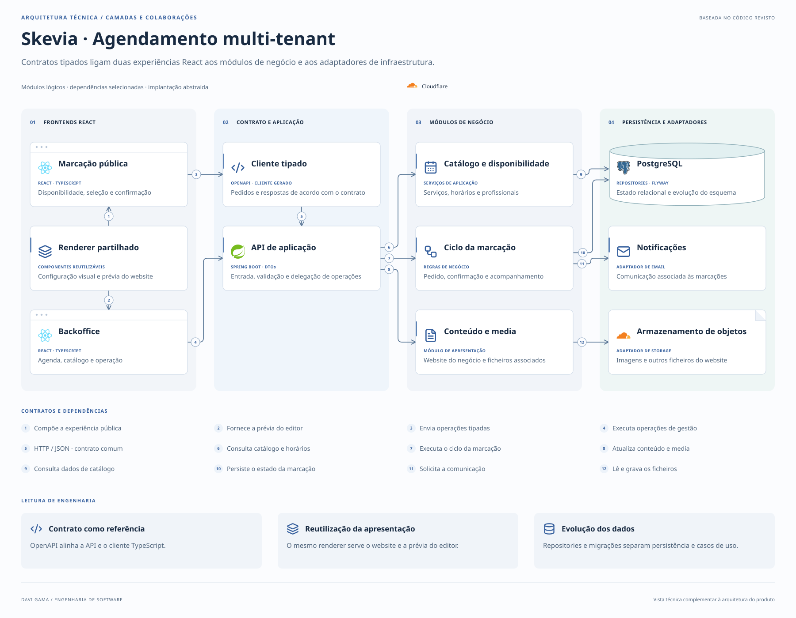

- **Contrato como referência:** OpenAPI alinha a API e o cliente TypeScript.
- **Reutilização da apresentação:** O mesmo renderer serve o website e a prévia do editor.
- **Evolução dos dados:** Repositories e migrações separam persistência e casos de uso.

[SVG vetorial](architecture/technical/multi-tenant.svg) · [PNG em alta resolução](architecture/technical/multi-tenant.png)

[Arquitetura pública](architecture/multi-tenant.svg) · [Imagem estática 4K](assets/portfolio/multi-tenant-poster.webp)

### Marta · Her Legacy

**Da descoberta da marca à sessão de diagnóstico, mentoria e lista de espera do planner.**

Website da Marta Silva que apresenta a sua abordagem de organização pessoal e transforma o interesse em pedidos de acompanhamento. A versão atual reúne sessão gratuita de diagnóstico, serviços de mentoria, apresentação do Protocolo Mente no Papel e lista de espera do Her Legacy Planner.

Interface original Her Legacy da main: diagnóstico, Protocolo Mente no Papel, planner, serviços e contacto. Capturas nativas de outubro de 2026.

Casos de uso, interface e backend

- Conhecer a proposta da marca e identificar necessidades através do diagnóstico de rotina.
- Pedir uma sessão gratuita com nome, email e contacto telefónico.
- Consultar os serviços de mentoria e manifestar interesse no Protocolo Mente no Papel.
- Inscrever-se na lista de espera do Her Legacy Planner.
- Enviar uma mensagem e receber a confirmação do pedido.

**Interface:** Homepage editorial com hero fotográfico, apresentação da Marta, diagnóstico de rotina, formulário de sessão gratuita, Protocolo Mente no Papel, testemunhos, planner e perguntas frequentes. Páginas próprias de serviços/mentoria, sobre e contacto. Formulários apresentam validação, envio, confirmação e erro.

**Backend e dados:** Next.js valida os pedidos e encaminha-os para o serviço Spring Boot de email. O serviço envia a mensagem à marca e a confirmação ao interessado. A sessão de diagnóstico reutiliza o fluxo de contacto com o contexto da candidatura. Os pedidos não são persistidos numa base de dados.

**Tecnologias:** Next.js, React, TypeScript, Spring Boot, Email

Diagrama de arquitetura · componentes e fluxos

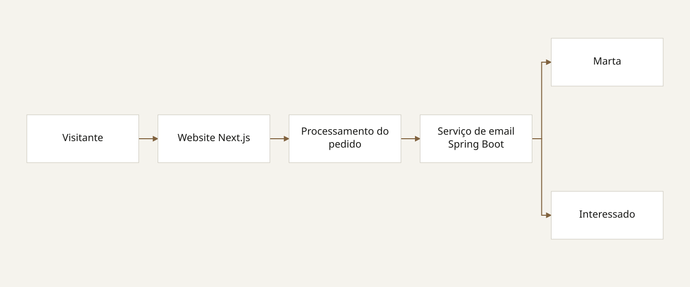

[SVG vetorial](architecture/marta.svg) · [PNG em alta resolução](architecture/marta.png)

Vista técnica · camadas, contratos e padrões

O formulário atravessa a camada Next.js e um serviço de aplicação, chegando ao email por uma abstração de envio.

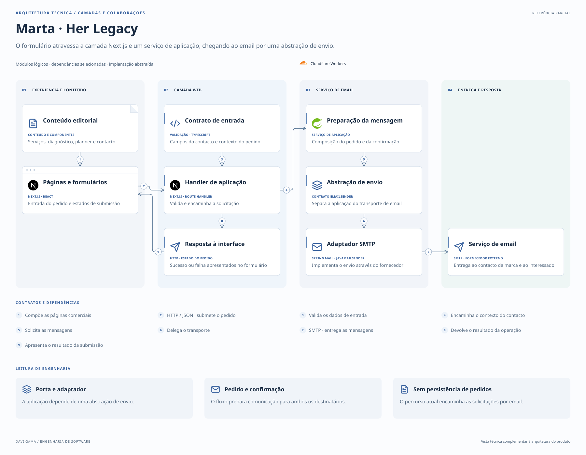

- **Porta e adaptador:** A aplicação depende de uma abstração de envio.
- **Pedido e confirmação:** O fluxo prepara comunicação para ambos os destinatários.
- **Sem persistência de pedidos:** O percurso atual encaminha as solicitações por email.

[SVG vetorial](architecture/technical/marta.svg) · [PNG em alta resolução](architecture/technical/marta.png)

[Arquitetura pública](architecture/marta.svg) · [Imagem estática 4K](assets/portfolio/marta-poster.webp)

### Coimbra MMA

**Uma academia acessível a quem chega de qualquer lugar.**

Uma academia de artes marciais em Coimbra precisava apresentar modalidades, horários e contacto com clareza para públicos locais e internacionais.

<a href="assets/portfolio/coimbra-mma-poster.webp">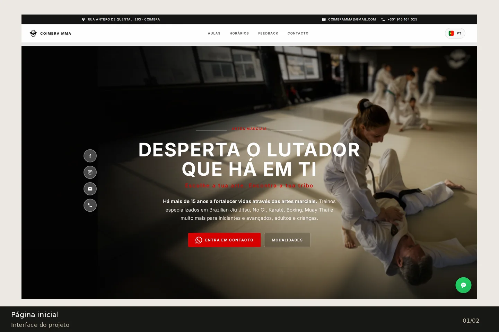</a>

Interface original: apresentação, assistente de modalidade, horários e seletor de idiomas.

Casos de uso, interface e backend

- Descobrir a academia e comparar modalidades.
- Usar o assistente de modalidades para encontrar uma opção adequada.
- Consultar a grelha de horários e abrir detalhes de uma aula.
- Mudar de idioma e encontrar os canais de contacto.

**Interface:** Website adaptável com modalidades, horários, informação da academia e contacto. Inclui um assistente para encontrar uma modalidade adequada, detalhes das aulas em diálogo e navegação em oito idiomas.

**Backend e dados:** Conteúdo estático gerado por Astro, componentes reutilizáveis e validação das traduções no build. A experiência pública não exige API.

**Tecnologias:** Astro, JavaScript, i18n, SEO

Diagrama de arquitetura · componentes e fluxos

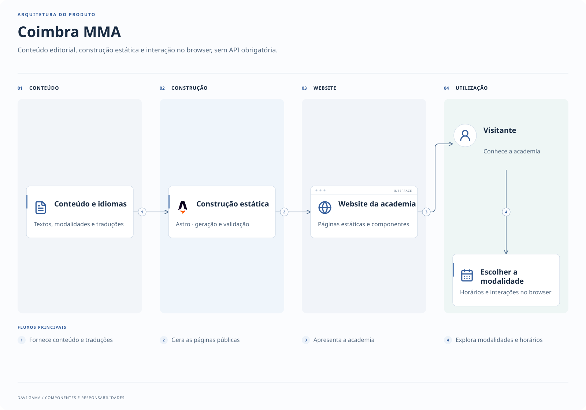

[SVG vetorial](architecture/coimbra-mma.svg) · [PNG em alta resolução](architecture/coimbra-mma.png)

Vista técnica · camadas, contratos e padrões

Conteúdo multilingue e componentes Astro produzem páginas estáticas, complementadas por interações locais no browser.

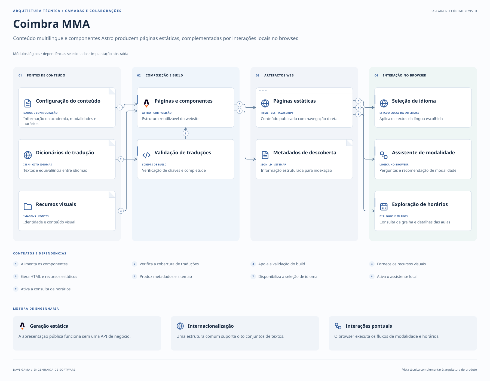

- **Geração estática:** A apresentação pública funciona sem uma API de negócio.
- **Internacionalização:** Uma estrutura comum suporta oito conjuntos de textos.
- **Interações pontuais:** O browser executa os fluxos de modalidade e horários.

[SVG vetorial](architecture/technical/coimbra-mma.svg) · [PNG em alta resolução](architecture/technical/coimbra-mma.png)

[Arquitetura pública](architecture/coimbra-mma.svg) · [Imagem estática 4K](assets/portfolio/coimbra-mma-poster.webp)

### Dalliany Tavares Advocacia

**Presença digital editorial para serviços jurídicos.**

Projeto de site multipágina para explicar áreas de atuação e facilitar a descoberta dos serviços, com conteúdo sujeito a confirmação antes da publicação.

<a href="assets/portfolio/dalliany-poster.webp">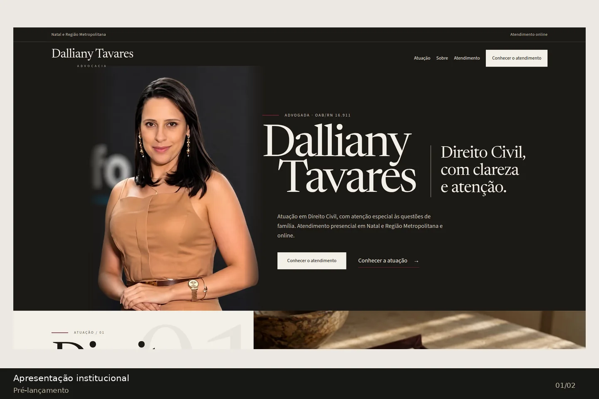</a>

Interface original de pré-lançamento. Capturas locais de apresentação e áreas de atuação.

Casos de uso, interface e backend

- Visitante conhece as áreas de atuação e a profissional.
- Consulta informação sobre o atendimento presencial ou online.
- Navega para o contacto pelos canais confirmados do projeto.

**Interface:** Páginas estáticas responsivas, imagens editoriais otimizadas e navegação que funciona sem JavaScript.

**Backend e dados:** Astro SSG e TypeScript, conteúdo estruturado e validações de build. Integrações de contacto ainda dependem de confirmação do cliente.

**Tecnologias:** Astro, TypeScript, SEO

Diagrama de arquitetura · componentes e fluxos

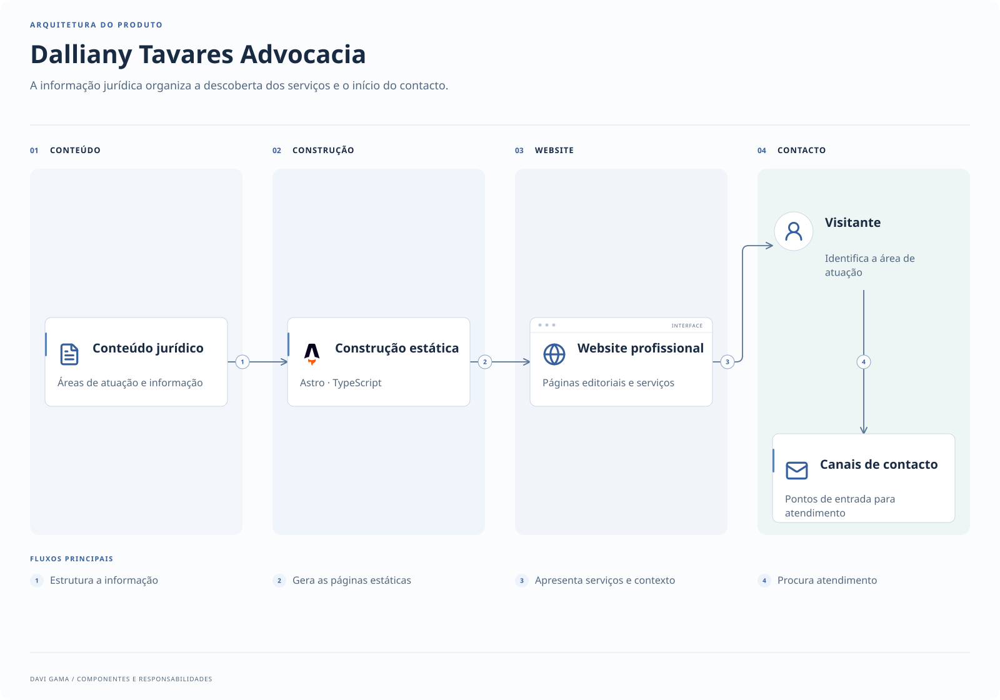

[SVG vetorial](architecture/dalliany.svg) · [PNG em alta resolução](architecture/dalliany.png)

Vista técnica · camadas, contratos e padrões

Uma aplicação multipágina organiza conteúdo editorial e media responsiva, com melhoria progressiva no browser.

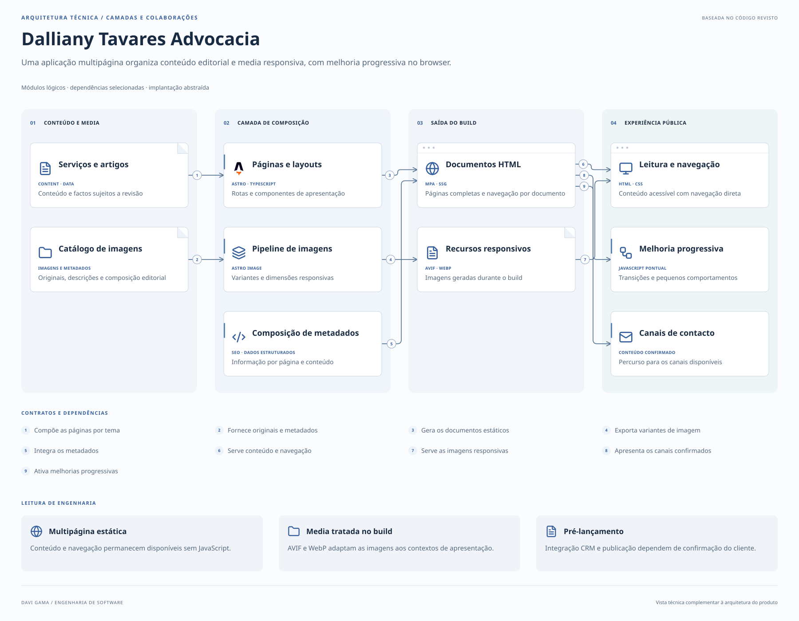

- **Multipágina estática:** Conteúdo e navegação permanecem disponíveis sem JavaScript.
- **Media tratada no build:** AVIF e WebP adaptam as imagens aos contextos de apresentação.
- **Pré-lançamento:** Integração CRM e publicação dependem de confirmação do cliente.

[SVG vetorial](architecture/technical/dalliany.svg) · [PNG em alta resolução](architecture/technical/dalliany.png)

[Arquitetura pública](architecture/dalliany.svg) · [Imagem estática 4K](assets/portfolio/dalliany-poster.webp)

### Thiago Santos English Platform

**Conteúdo educativo com percurso de compra digital.**

Plataforma para apresentar cursos de inglês, ebooks e produtos digitais e conduzir o visitante até ao pagamento.

Website Eleventy construído a partir da main. Cursos, ebooks e carrinho local; sem transação de pagamento.

Casos de uso, interface e backend

- Visitante conhece os cursos de inglês e os ebooks.
- Seleciona um produto e avança no percurso de compra.
- O servidor coordena a integração de pagamento com Mercado Pago e Pix.

**Interface:** Experiência de conteúdo em Eleventy com templates Nunjucks e páginas comerciais.

**Backend e dados:** Fluxos de servidor em Node.js e Express, com integração de pagamento Mercado Pago e Pix.

**Tecnologias:** Eleventy, Node.js, Express, Mercado Pago

Diagrama de arquitetura · componentes e fluxos

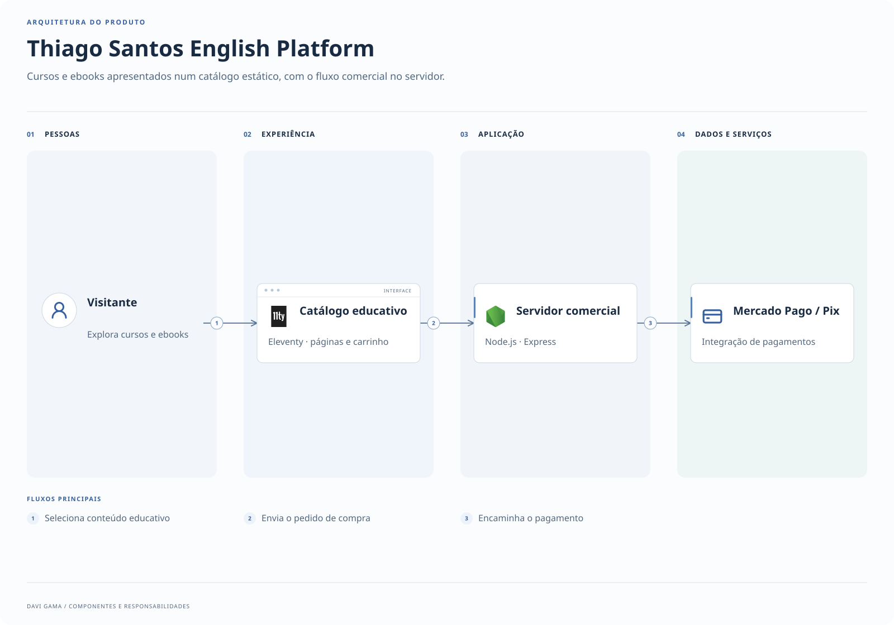

[SVG vetorial](architecture/thiago.svg) · [PNG em alta resolução](architecture/thiago.png)

Vista técnica · camadas, contratos e padrões

O conteúdo é compilado por Eleventy; o browser reúne a seleção e o servidor coordena o percurso comercial.

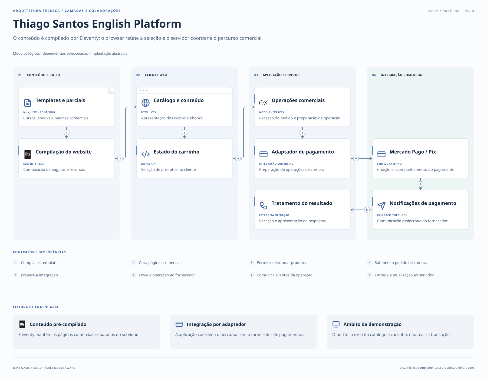

- **Conteúdo pré-compilado:** Eleventy mantém as páginas comerciais separadas do servidor.
- **Integração por adaptador:** A aplicação coordena o percurso com o fornecedor de pagamentos.
- **Âmbito da demonstração:** O portfólio exercita catálogo e carrinho; não realiza transações.

[SVG vetorial](architecture/technical/thiago.svg) · [PNG em alta resolução](architecture/technical/thiago.png)

[Arquitetura pública](architecture/thiago.svg) · [Imagem estática 4K](assets/portfolio/thiago-poster.webp)

### 503

**Publicar com método. Ler sem ruído.**

Uma publicação independente precisava separar a experiência de leitura do fluxo interno de criação e publicação de artigos.

<a href="assets/portfolio/503-poster.webp">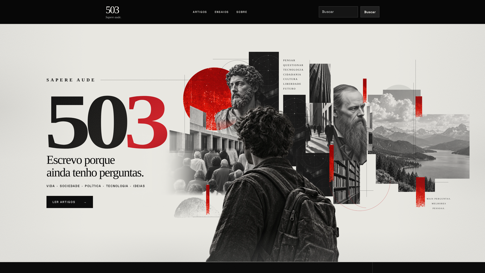</a>

Site Astro, administração React e API Spring Boot executados localmente. Artigos e conta de demonstração.

Casos de uso, interface e backend

- Explorar artigos e categorias e abrir uma leitura dedicada.
- Criar e editar artigos por blocos no backoffice.
- Definir capa, metadados e categoria antes de publicar.
- Rever os requisitos de publicação e manter o conteúdo editorial.

**Interface:** Leitura e descoberta de artigos no website Astro. No backoffice React, edição por blocos, gestão de categorias, imagem de capa, campos editoriais e checklist de publicação.

**Backend e dados:** API Spring Boot que centraliza o ciclo editorial e persiste artigos em PostgreSQL; implantação com Azure e Cloudflare.

**Tecnologias:** Spring Boot, Astro, React, PostgreSQL

Diagrama de arquitetura · componentes e fluxos

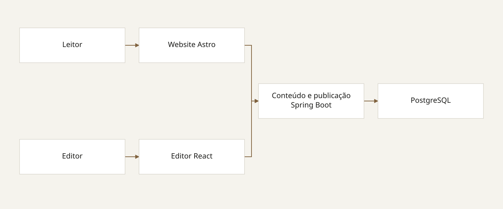

[SVG vetorial](architecture/503.svg) · [PNG em alta resolução](architecture/503.png)

Vista técnica · camadas, contratos e padrões

Duas aplicações de apresentação usam os serviços editoriais; persistência e publicação ficam sob responsabilidade da API.

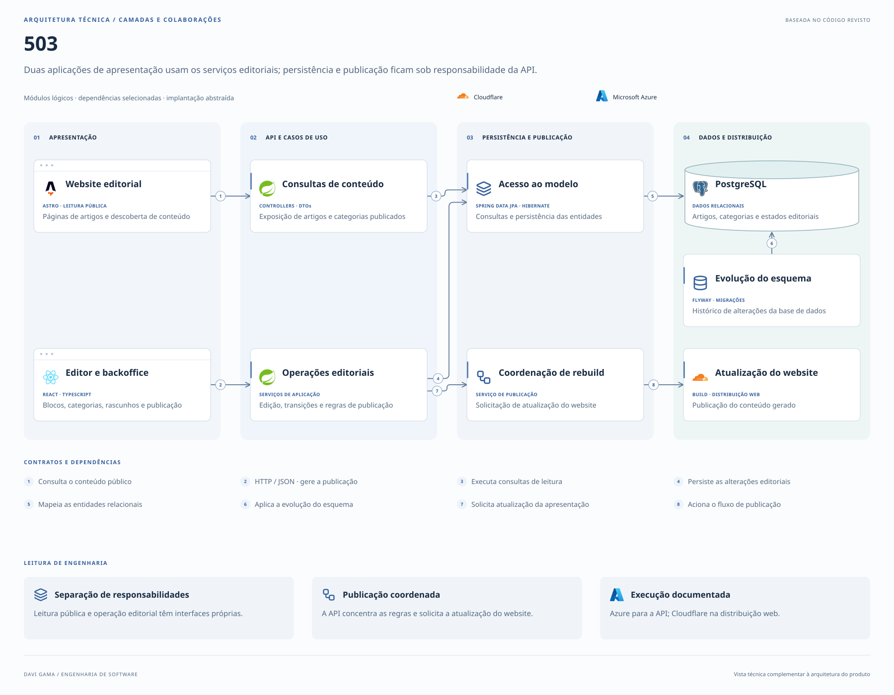

- **Separação de responsabilidades:** Leitura pública e operação editorial têm interfaces próprias.
- **Publicação coordenada:** A API concentra as regras e solicita a atualização do website.
- **Execução documentada:** Azure para a API; Cloudflare na distribuição web.

[SVG vetorial](architecture/technical/503.svg) · [PNG em alta resolução](architecture/technical/503.png)

[Arquitetura pública](architecture/503.svg) · [Imagem estática 4K](assets/portfolio/503-poster.webp)

### AssessFlow

**Avaliações ao vivo, na nuvem ou em rede local.**

Plataforma para autores prepararem bancos de perguntas e avaliações reutilizáveis, e para docentes conduzirem sessões com participação e resultados em tempo real. Funciona pela internet ou numa rede local através do modo Local Live.

<a href="assets/portfolio/assessflow-poster.webp">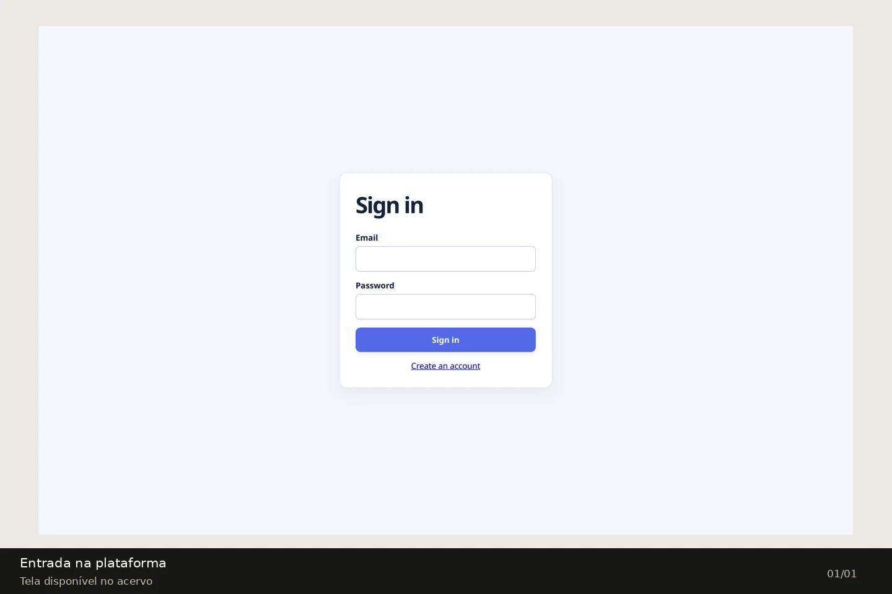</a>

Interface atualizada em 28/10/2026. React, API Spring Boot e PostgreSQL locais; perguntas, sessão e resultados reais com três participantes fictícios.

Casos de uso, interface e backend

- Criar perguntas e organizar um banco reutilizável.
- Montar uma avaliação, definir as perguntas e publicá-la.
- Abrir uma sessão, apresentar o código de entrada e acompanhar os participantes.
- Iniciar perguntas e acompanhar as respostas e os resultados.
- Concluir a sessão e exportar resultados em CSV; usar Local Live numa rede local.

**Interface:** Workspace por organização com navegação lateral, banco de perguntas filtrável e construtor com seleção, pontuação e ordem em áreas distintas. Sala ao vivo com código e QR, lista de participantes e resultados visuais; interface do participante com alto contraste e seleção explícita da resposta.

**Backend e dados:** API Spring Boot com PostgreSQL e comunicação WebSocket. Organizações separam os dados; modo local permite sessões numa LAN.

**Tecnologias:** Spring Boot, React, PostgreSQL, WebSocket

Diagrama de arquitetura · componentes e fluxos

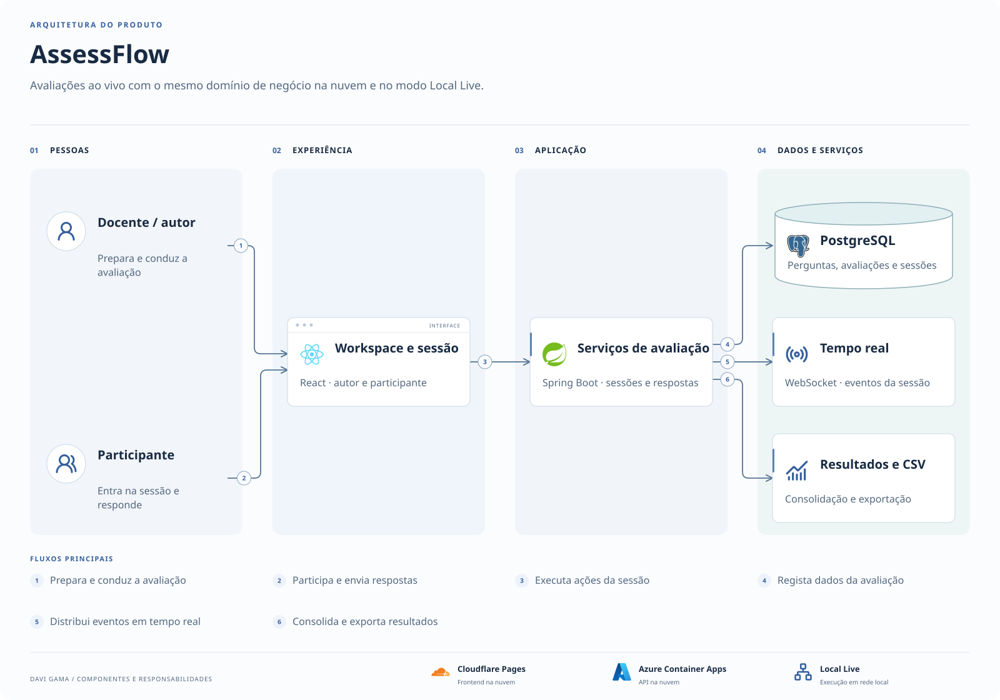

[SVG vetorial](architecture/assessflow.svg) · [PNG em alta resolução](architecture/assessflow.png)

Vista técnica · camadas, contratos e padrões

O domínio de avaliações combina operações HTTP, eventos de sessão e persistência; o modo Local Live reutiliza a aplicação.

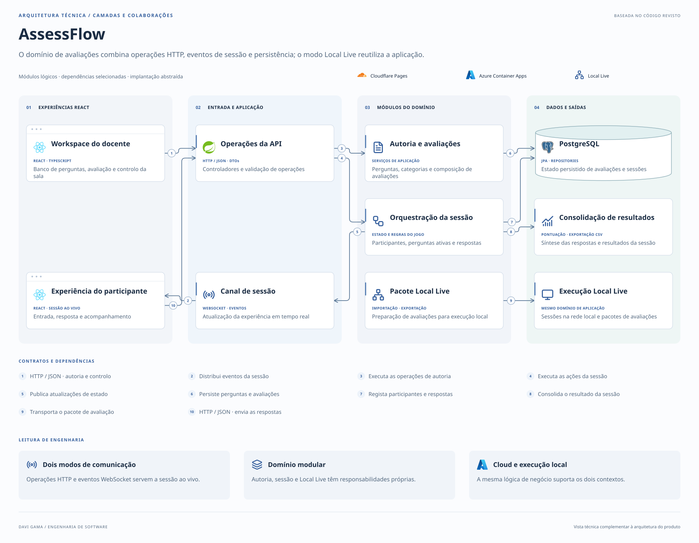

- **Dois modos de comunicação:** Operações HTTP e eventos WebSocket servem a sessão ao vivo.
- **Domínio modular:** Autoria, sessão e Local Live têm responsabilidades próprias.
- **Cloud e execução local:** A mesma lógica de negócio suporta os dois contextos.

[SVG vetorial](architecture/technical/assessflow.svg) · [PNG em alta resolução](architecture/technical/assessflow.png)

[Arquitetura pública](architecture/assessflow.svg) · [Código](https://github.com/DaviGama08/assessflow) · [Imagem estática 4K](assets/portfolio/assessflow-poster.webp)

## Projetos académicos

Aplicações e sistemas desenvolvidos durante a formação no ISEC.

### Distributed Quiz

**Uma sessão que continua mesmo após falhas.**

Projeto académico para gerir questionários entre professor e alunos, mantendo sessões disponíveis perante a falha de um serviço.

<a href="assets/portfolio/distributed-quiz-poster.webp">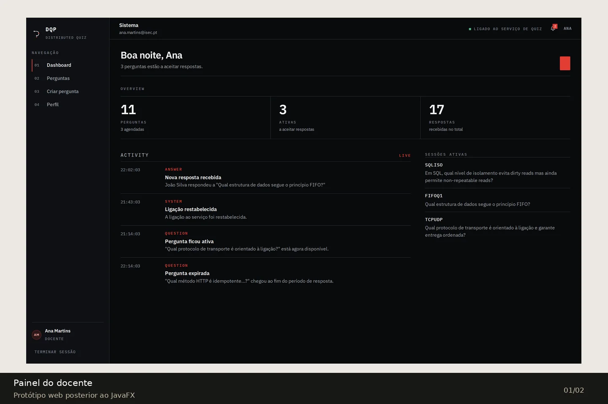</a>

Interface JavaFX original com respostas de rede substituídas por dados de demonstração. Não representa validação do sistema distribuído em execução.

Casos de uso, interface e backend

- Professor cria perguntas e disponibiliza uma sessão a alunos.
- Alunos entram na sessão, recebem perguntas e enviam respostas.
- O sistema recupera o serviço e a sessão quando um servidor deixa de responder.

**Interface:** Clientes JavaFX para docentes e participantes. O docente cria e gere perguntas e acompanha respostas; o aluno entra por código, responde e consulta o histórico.

**Backend e dados:** Serviços Java com descoberta, replicação primário/backup, heartbeat, failover e persistência SQLite; TCP, UDP e multicast.

**Tecnologias:** Java, JavaFX, TCP / UDP, SQLite

Diagrama de arquitetura · componentes e fluxos

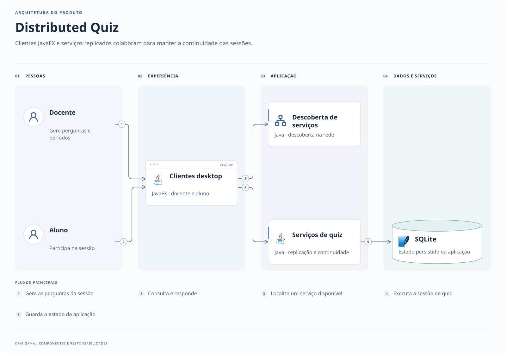

[SVG vetorial](architecture/distributed-quiz.svg) · [PNG em alta resolução](architecture/distributed-quiz.png)

Vista técnica · camadas, contratos e padrões

Descoberta, pedidos e replicação usam canais distintos para coordenar clientes desktop e servidores de quiz.

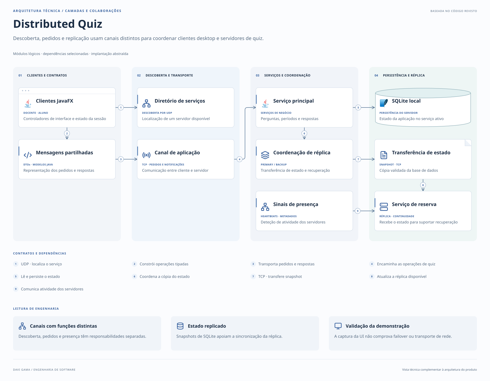

- **Canais com funções distintas:** Descoberta, pedidos e presença têm responsabilidades separadas.
- **Estado replicado:** Snapshots de SQLite apoiam a sincronização da réplica.
- **Validação da demonstração:** A captura da UI não comprova failover ou transporte de rede.

[SVG vetorial](architecture/technical/distributed-quiz.svg) · [PNG em alta resolução](architecture/technical/distributed-quiz.png)

[Arquitetura pública](architecture/distributed-quiz.svg) · [Código](https://github.com/DaviGama08/distributed-quiz-platform-isec) · [Imagem estática 4K](assets/portfolio/distributed-quiz-poster.webp)

### MyMEDIA Marketplace

**Comércio multimédia em várias interfaces.**

Marketplace académico de multimédia que reúne clientes, fornecedores e operação interna. Cobre catálogo e inventário, compras e alugueres, favoritos, carrinho e processos de aprovação.

Sem captura nova aprovada. A referência local foi revista; a branch remota e a execução atual ainda precisam de validação.

Casos de uso, interface e backend

- Pesquisar o catálogo, guardar favoritos e preparar compras ou alugueres.
- Gerir produtos, categorias e inventário.
- Acompanhar encomendas e operações do marketplace.
- Aprovar intervenientes e executar tarefas administrativas.

**Interface:** Loja pública, back office em Blazor e cliente MAUI Hybrid, com fluxos de catálogo, carrinho e favoritos.

**Backend e dados:** API REST em ASP.NET Core, Entity Framework Core e SQL Server, com autenticação e papéis.

**Tecnologias:** C#, .NET, Blazor, SQL Server

Diagrama de arquitetura · componentes e fluxos

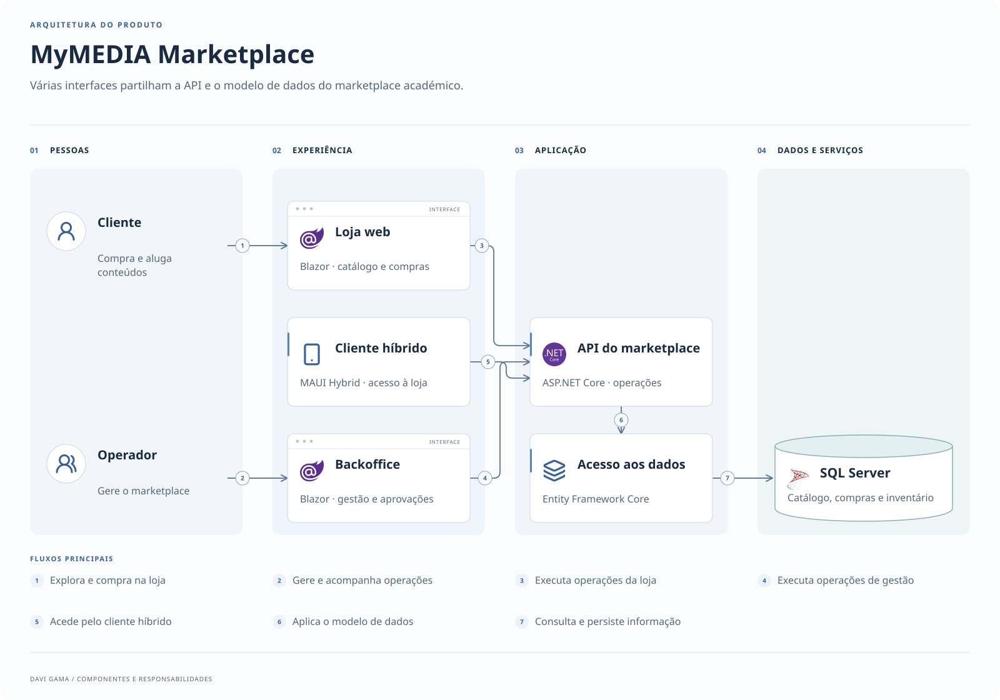

[SVG vetorial](architecture/mymedia.svg) · [PNG em alta resolução](architecture/mymedia.png)

Vista técnica · camadas, contratos e padrões

Clientes web e híbridos partilham contratos HTTP, repositórios e um modelo relacional de marketplace.

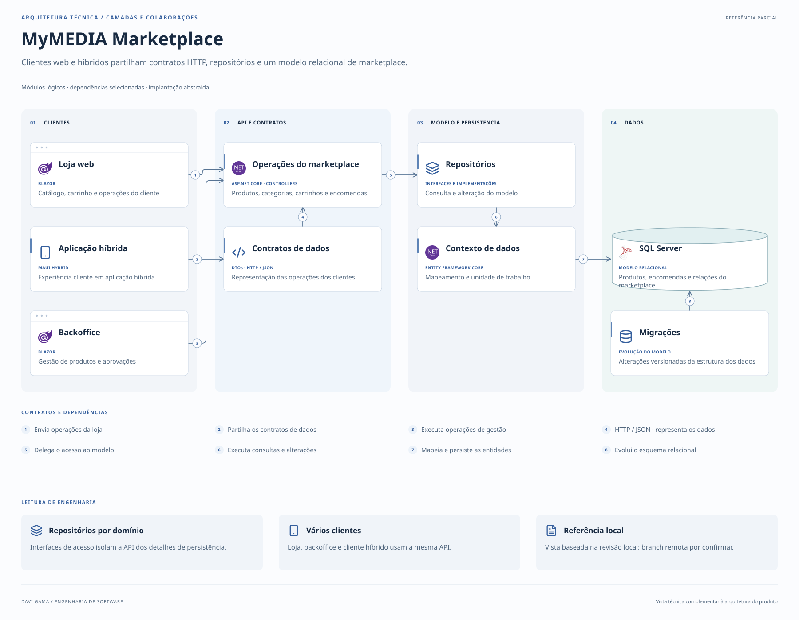

- **Repositórios por domínio:** Interfaces de acesso isolam a API dos detalhes de persistência.
- **Vários clientes:** Loja, backoffice e cliente híbrido usam a mesma API.
- **Referência local:** Vista baseada na revisão local; branch remota por confirmar.

[SVG vetorial](architecture/technical/mymedia.svg) · [PNG em alta resolução](architecture/technical/mymedia.png)

[Arquitetura pública](architecture/mymedia.svg)

### JavaFX Chess

**As regras do xadrez traduzidas em software testável.**

Aplicação desktop que implementa partidas completas e permite continuar jogos guardados.

<a href="assets/portfolio/javafx-chess-poster.webp">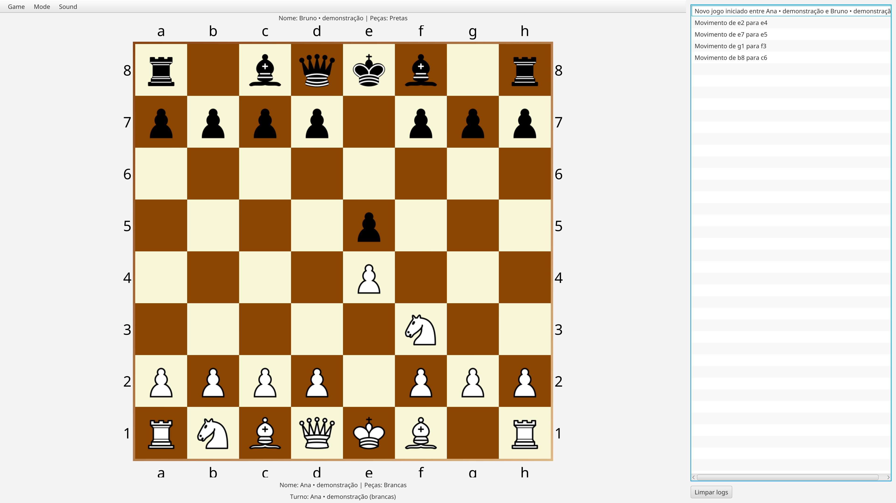</a>

Aplicação JavaFX original, executada com o modelo real: partida local, movimentos possíveis e edição de posições.

Casos de uso, interface e backend

- Jogar uma partida local com validação das regras.
- Explorar movimentos legais no modo de aprendizagem.
- Guardar a partida, editar posições e desfazer ou refazer jogadas.

**Interface:** Aplicação JavaFX para dois jogadores locais, com tabuleiro, aprendizagem de movimentos, editor de posições e histórico da partida.

**Backend e dados:** Lógica Java para validação de jogadas, xeque, roque, desfazer/refazer e persistência, organizada em MVC.

**Tecnologias:** Java, JavaFX, Maven, JUnit

Diagrama de arquitetura · componentes e fluxos

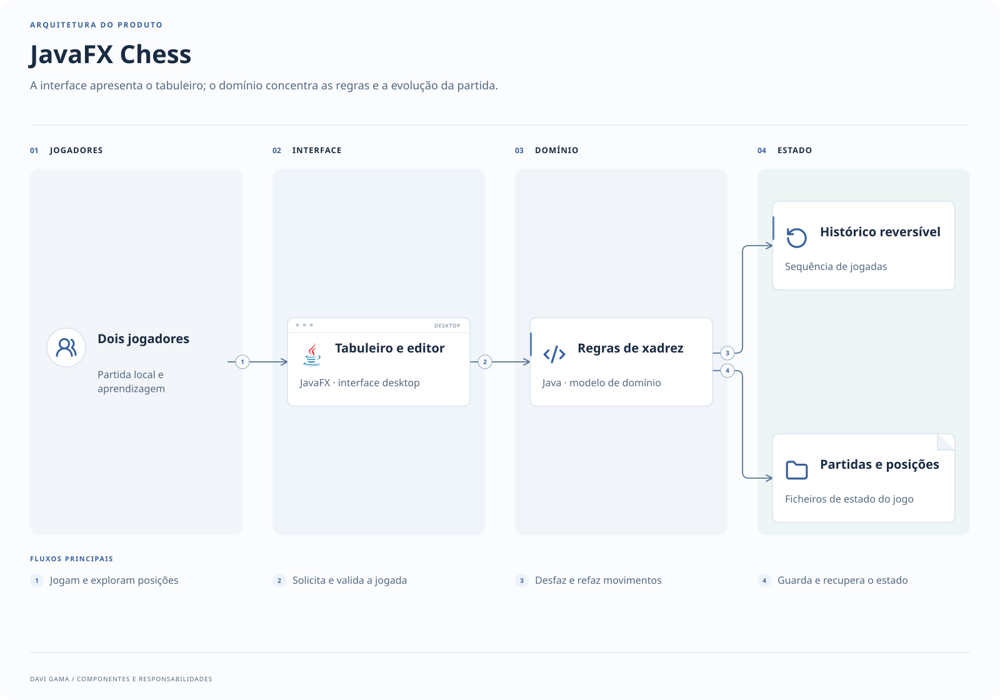

[SVG vetorial](architecture/javafx-chess.svg) · [PNG em alta resolução](architecture/javafx-chess.png)

Vista técnica · camadas, contratos e padrões

MVC, Facade e Memento organizam a interação, as regras da partida e a recuperação de estados.

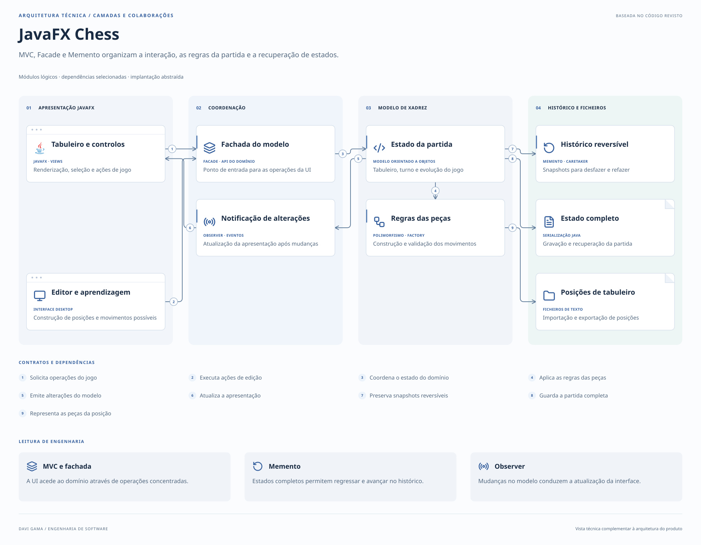

- **MVC e fachada:** A UI acede ao domínio através de operações concentradas.
- **Memento:** Estados completos permitem regressar e avançar no histórico.
- **Observer:** Mudanças no modelo conduzem a atualização da interface.

[SVG vetorial](architecture/technical/javafx-chess.svg) · [PNG em alta resolução](architecture/technical/javafx-chess.png)

[Arquitetura pública](architecture/javafx-chess.svg) · [Código](https://github.com/davigama-academic/javafx-chess-isec) · [Imagem estática 4K](assets/portfolio/javafx-chess-poster.webp)

### SurpriseMe

**Ideias de presente no contexto de pessoas e datas.**

Aplicação para gerir destinatários, ocasiões e histórico de presentes, ajudando a evitar repetições.

<a href="assets/portfolio/surpriseme-poster.webp">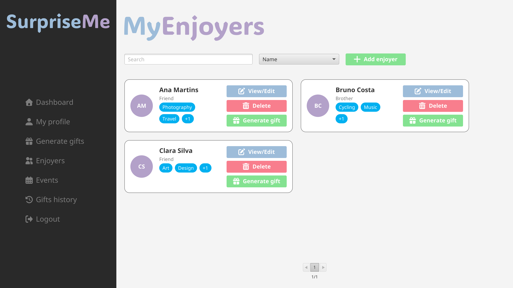</a>

Aplicação JavaFX original com destinatários e eventos fictícios. O formulário de sugestões é apresentado sem chamada ao serviço de IA.

Casos de uso, interface e backend

- Gerir destinatários com interesses e preferências.
- Organizar datas e consultar o histórico de presentes.
- Obter sugestões de presente e de mensagem para um cartão.

**Interface:** Aplicação JavaFX para organizar destinatários, interesses, eventos e histórico de presentes, com um assistente para configurar pedidos de sugestões.

**Backend e dados:** Lógica Java e persistência local para relacionar destinatários, eventos e presentes.

**Tecnologias:** Java, JavaFX

Diagrama de arquitetura · componentes e fluxos

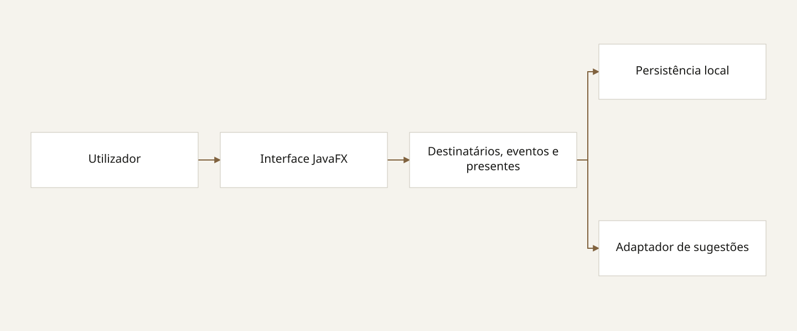

[SVG vetorial](architecture/surpriseme.svg) · [PNG em alta resolução](architecture/surpriseme.png)

Vista técnica · camadas, contratos e padrões

A interface coordena destinatários e eventos; persistência e geração de sugestões usam componentes separados.

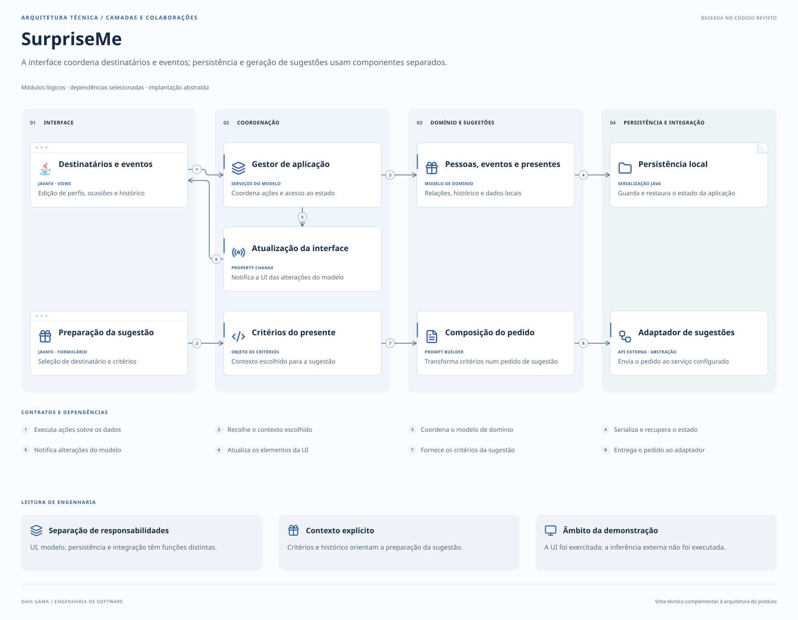

- **Separação de responsabilidades:** UI, modelo, persistência e integração têm funções distintas.
- **Contexto explícito:** Critérios e histórico orientam a preparação da sugestão.
- **Âmbito da demonstração:** A UI foi exercitada; a inferência externa não foi executada.

[SVG vetorial](architecture/technical/surpriseme.svg) · [PNG em alta resolução](architecture/technical/surpriseme.png)

[Arquitetura pública](architecture/surpriseme.svg) · [Código](https://github.com/davigama-academic/surpriseme-gift-assistant-isec) · [Imagem estática 4K](assets/portfolio/surpriseme-poster.webp)

### Unix Topic Message Broker

**Mensagens por tópico entre processos independentes.**

Estudo prático de comunicação concorrente e entrega persistente de mensagens num sistema Unix.

Projeto de terminal. Sem acesso atual ao código e sem captura de execução aprovada nesta edição.

Casos de uso, interface e backend

- Um cliente subscreve os tópicos que pretende acompanhar.
- Outro cliente publica uma mensagem num tópico.
- O gestor coordena entrega concorrente e mensagens persistentes.

**Interface:** Clientes de linha de comandos para publicar e subscrever tópicos; não possui interface gráfica.

**Backend e dados:** Gestor central em C com named pipes POSIX, pthreads, select e sinais.

**Tecnologias:** C, POSIX IPC, pthreads

Diagrama de arquitetura · componentes e fluxos

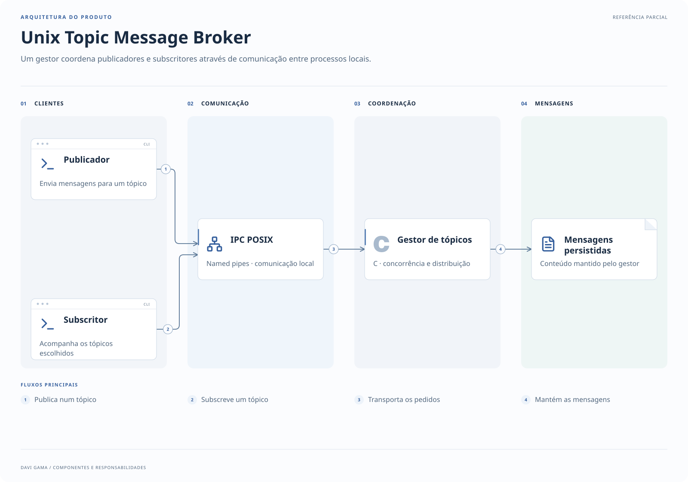

[SVG vetorial](architecture/unix-broker.svg) · [PNG em alta resolução](architecture/unix-broker.png)

Vista técnica · camadas, contratos e padrões

Vista técnica conceptual dos mecanismos documentados: processos clientes, IPC POSIX, coordenação e mensagens persistentes.

Vista conceptual baseada na documentação histórica; código atual por confirmar.

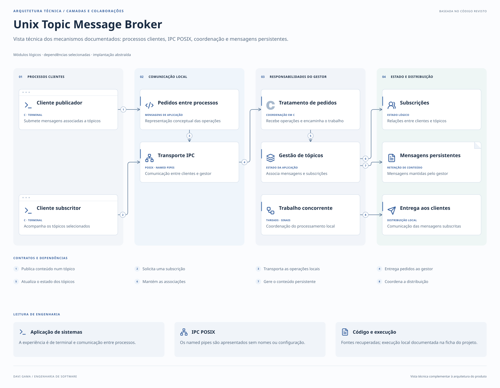

- **Aplicação de sistemas:** A experiência é de terminal e comunicação entre processos.
- **IPC POSIX:** Os named pipes são apresentados sem nomes ou configuração.
- **Vista conceptual:** Decomposição de responsabilidades; código atual indisponível.

[SVG vetorial](architecture/technical/unix-broker.svg) · [PNG em alta resolução](architecture/technical/unix-broker.png)

[Arquitetura pública](architecture/unix-broker.svg)

### Windows IPC Word Game

**Um jogo multiplayer entre processos Windows.**

Projeto académico para aplicar comunicação e sincronização entre jogadores humanos, bots e monitorização.

Aplicação Win32. Sem acesso atual ao código e sem captura de execução aprovada nesta edição.

Casos de uso, interface e backend

- Jogadores humanos participam num jogo de palavras.
- Bots autónomos interagem com a mesma sessão.
- Um painel Win32 acompanha o estado da aplicação.

**Interface:** Clientes nativos e painel de monitorização Win32.

**Backend e dados:** C e API Win32 com named pipes, memória partilhada e threads.

**Tecnologias:** C, Win32 API, Named Pipes

Diagrama de arquitetura · componentes e fluxos

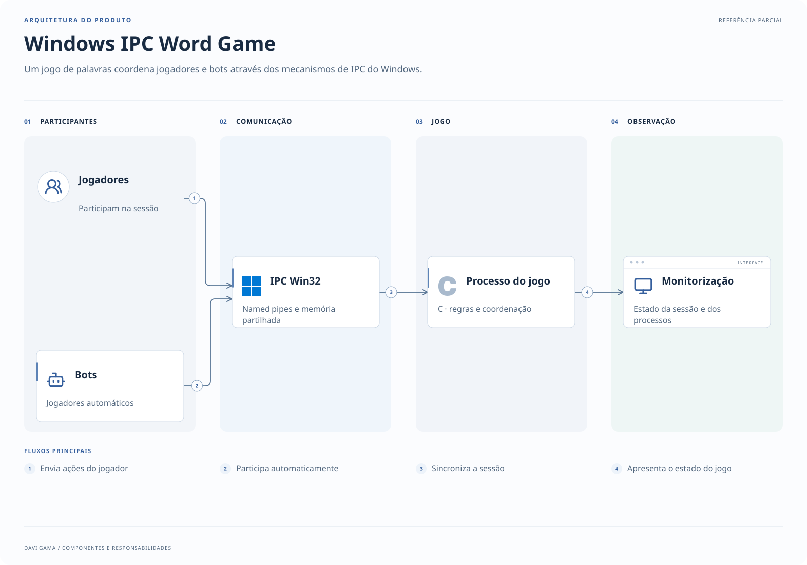

[SVG vetorial](architecture/windows-game.svg) · [PNG em alta resolução](architecture/windows-game.png)

Vista técnica · camadas, contratos e padrões

Vista técnica conceptual do jogo multiprocesso: mensagens, estado partilhado, coordenação e observação em Win32.

Vista conceptual baseada na documentação histórica; código atual por confirmar.

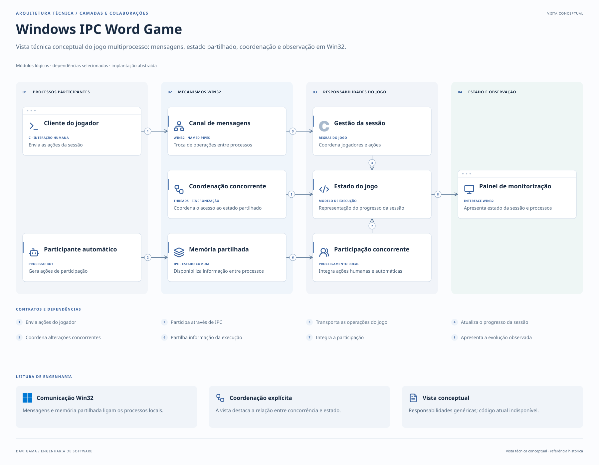

- **Comunicação Win32:** Mensagens e memória partilhada ligam os processos locais.
- **Coordenação explícita:** A vista destaca a relação entre concorrência e estado.
- **Vista conceptual:** Responsabilidades genéricas; código atual indisponível.

[SVG vetorial](architecture/technical/windows-game.svg) · [PNG em alta resolução](architecture/technical/windows-game.png)

[Arquitetura pública](architecture/windows-game.svg)

### Outros estudos académicos

- **SafetySec Android** — Aplicação académica de monitorização com alertas de emergência, geofencing e deteção por sensores.
- **Desert Caravan Simulator** — Simulador por turnos com caravanas, comércio, movimento autónomo, eventos e combate.
- **Neural Shape Classifier** — Comparação de redes feedforward e interface para treino e classificação de formas geométricas.
- **AMOV Flutter** — Projeto académico de desenvolvimento móvel preservado no arquivo da formação.

## Qualificações e experiência

- **Licenciatura em Engenharia Informática — ISEC, 2022–2026.** Especialização em Desenvolvimento de Aplicações; conclusão em julho de 2026.
- **Software Engineering Intern — Intermedia Intelligent Communications, março–agosto de 2026.** Pipeline de anonimização com modelos locais, preparação e avaliação de datasets, API FastAPI e interface React/Vite.
- **Desenvolvimento freelance desde junho de 2025.** Levantamento de necessidades, frontend, backend, integrações, publicação e manutenção.

**Backend e dados:** Java, Spring Boot, C#, ASP.NET Core, Python, FastAPI, PostgreSQL, MySQL, SQL Server e SQLite.  
**Interfaces:** React, TypeScript, Next.js, Astro, Angular, Blazor e JavaFX.  
**Qualidade e entrega:** JUnit, Testcontainers, Vitest, Playwright, Docker e CI/CD.

Disponível para oportunidades em engenharia de software e projetos freelance. [Vamos conversar](mailto:davi.torres00pro@gmail.com).

Diagramas vetoriais com [créditos dos ícones](architecture/ATTRIBUTION.md).
