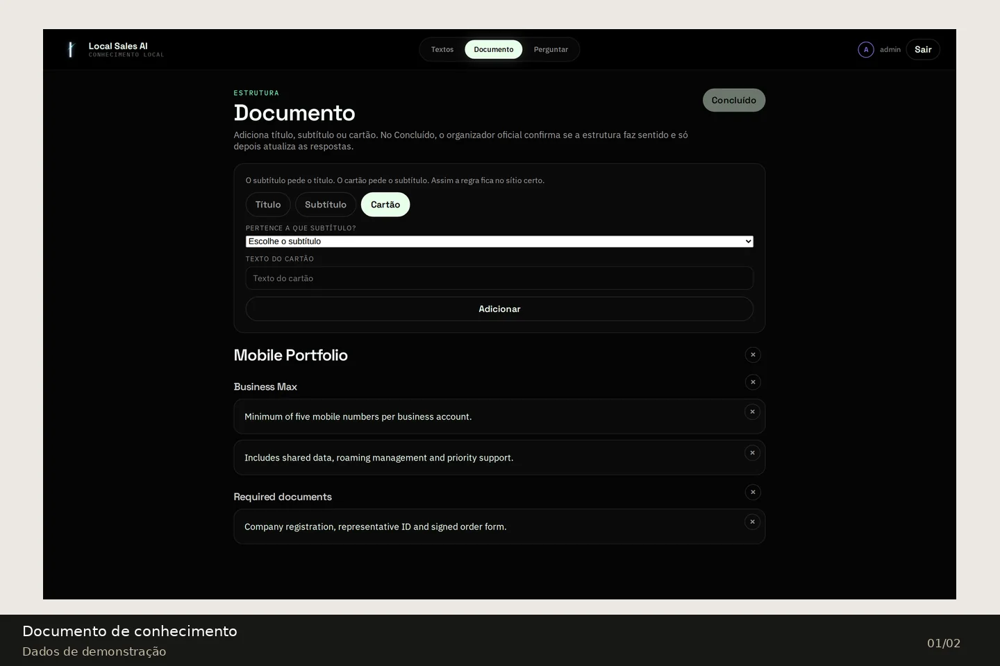
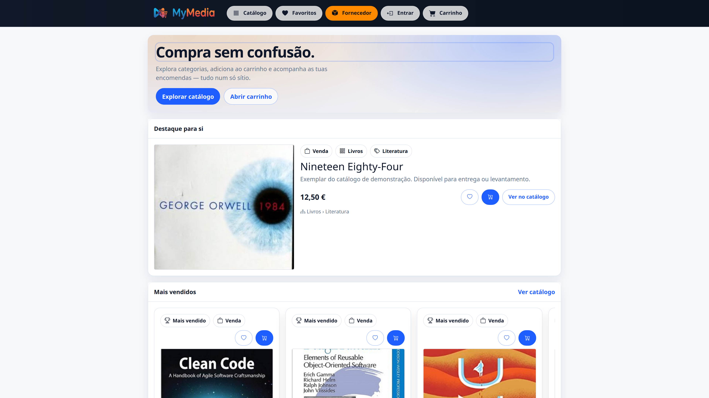

# Davi Gama

### Software Engineer · Backend & Web Development

Computer Engineering graduate from ISEC, based in Coimbra, Portugal. I build client websites, business applications and independent products, with a focus on Java, Spring Boot and clear domain modelling.

Available for software engineering opportunities and freelance projects, from requirements through implementation and maintenance.

[Email](mailto:davi.torres00pro@gmail.com) · [LinkedIn](https://www.linkedin.com/in/davinasser/) · [Portfolio PDF](portfolio/Davi_Gama_Portfolio_2026.pdf) · [Editable presentation](portfolio/Davi_Gama_Portfolio_2026.pptx)

## Professional Projects

Client delivery and independent products are identified separately. The case studies show business responsibilities and public-facing interfaces; private implementation and operational details remain outside this portfolio.

### Multi-tenant Scheduling · Ícaro’s Barbershop

**Independent product**

A shared platform for service businesses, combining a branded website, online bookings and daily operations. Ícaro’s Barbershop in Coimbra is an applied client case.

Customers choose a time, compatible services and a professional. The team manages bookings, services, packages, staff and website content. React public and administration interfaces use a Spring Boot API and PostgreSQL.

`Java` · `Spring Boot` · `React` · `TypeScript` · `PostgreSQL`

*October 2026 UI. Online payment is a future extension.*

### Marta · Her Legacy

**Client project**

A personal-brand MVP for mentorship applications, the Her Legacy Planner waitlist and contact enquiries.

Next.js forwards validated requests to a Spring Boot email service. The business and requester receive messages; requests are not stored in a database.

`Next.js` · `React` · `TypeScript` · `Spring Boot` · `Email`

*Visual archive: September 2026. The technical description reflects the current MVP; no catalogue, cart or payment flow is claimed.*

### Coimbra MMA

**Client project**

A multilingual website helping local and international visitors discover a martial arts academy, its disciplines, schedules and contact channels.

Astro generates lightweight static pages from structured content. Eight languages share the same page structure, with translation validation during the build.

`Astro` · `JavaScript` · `i18n` · `SEO`

*Client website UI.*

### Dalliany Tavares Advocacia

**Client project**

An editorial, multipage website presenting legal practice areas and ways to contact the practice.

Astro and TypeScript support reusable content and responsive imagery.

`Astro` · `TypeScript` · `SEO`

*Pre-launch UI; client details and contact channels are still being validated.*

### Thiago Santos English Platform

**Client project**

A client platform for English courses, ebooks and digital sales.

Eleventy provides the content experience; Node.js and Express coordinate server-side flows and Mercado Pago / Pix integration.

`Eleventy` · `Node.js` · `Express` · `Mercado Pago`

*No shareable UI capture is included.*

### 503 · Independent Publishing

**Independent product**

A publishing platform with a dedicated reading experience and an editorial administration workflow.

Astro serves the public website, React supports editing, and a Spring Boot API with PostgreSQL maintains content and publication state.

`Spring Boot` · `Astro` · `React` · `PostgreSQL`

*Project UI.*

### AssessFlow

**Independent product**

A platform for creating assessments and running live sessions online or over a local network.

React, Spring Boot, PostgreSQL and WebSocket support participation, reconnection and results.

`Spring Boot` · `React` · `PostgreSQL` · `WebSocket`

*The available capture shows the sign-in screen.*

[Source repository](https://github.com/DaviGama08/assessflow)

### Local Sales AI

**Independent product**

A workspace for organising commercial documents and asking questions with answers connected to their sources.

Spring Boot coordinates MySQL, local inference with Ollama and vector retrieval with Qdrant.

`Spring Boot` · `MySQL` · `Ollama` · `Qdrant`

*In development. Screens use demonstration documents and a simulated response.*

### AI Agent Console

**Independent product**

A development console for coordinating independent coding-agent sessions under explicit user control.

Java 21 coordinates processes and JSON-RPC communication, with JLine for terminal interaction and Gson for data handling.

`Java` · `JLine` · `Gson` · `JSON-RPC`

*In development; terminal application.*

### Skevia · Institutional Website

**Independent product**

The initial web foundation for Skevia’s public identity.

Astro and TypeScript provide the institutional site structure, independently from the scheduling product.

`Astro` · `TypeScript` · `CSS`

*Foundation implemented; no deployed-site claim.*

## Academic Projects

University engineering work is organised under [davigama-academic](https://github.com/davigama-academic). Where a preview is a later web prototype, it is explicitly identified.

### Distributed Quiz

**Academic project**

An academic teacher/student quiz system exploring recovery after service failures.

Java and JavaFX clients work with service discovery, replication and SQLite persistence over TCP, UDP and multicast.

`Java` · `JavaFX` · `TCP / UDP` · `SQLite`

*Preview: a later web UI prototype. The original academic application uses JavaFX.*

[Source repository](https://github.com/DaviGama08/distributed-quiz-platform-isec)

### MyMEDIA Marketplace

**Academic project**

An academic multimedia marketplace with catalogue, cart, favourites and back-office operations.

An ASP.NET Core API, Entity Framework Core and SQL Server serve Blazor interfaces and a MAUI Hybrid client.

`C#` · `.NET` · `Blazor` · `SQL Server`

*Project UI.*

### JavaFX Chess

**Academic project**

A local two-player chess application with legal-move validation, learning mode, position editing and reversible history.

JavaFX and a Java MVC model organise the application. Memento supports undo/redo; local persistence stores games and positions.

`Java` · `JavaFX` · `Maven` · `JUnit`

*Preview: a later web UI prototype, not the original JavaFX interface. No online or computer opponent is claimed.*

[Source repository](https://github.com/davigama-academic/javafx-chess-isec)

### SurpriseMe

**Academic project**

An academic gift-planning assistant for recipients, events, gift history and personalised suggestions.

JavaFX, application services and local persistence separate the domain from the suggestion-provider adapter.

`Java` · `JavaFX`

*Preview: a later web UI prototype. The original application uses JavaFX.*

[Source repository](https://github.com/davigama-academic/surpriseme-gift-assistant-isec)

### Unix Topic Message Broker

**Academic project**

A local topic-based messaging system with independent clients, concurrent delivery and persistent messages.

C, POSIX named pipes, pthreads, select and signals coordinate the manager and command-line clients.

`C` · `POSIX IPC` · `pthreads`

*Command-line application.*

### Windows IPC Word Game

**Academic project**

A multi-process word game with human clients, bots and a native monitoring panel.

C and the Win32 API use named pipes, shared memory and threads for communication and synchronisation.

`C` · `Win32 API` · `Named Pipes`

*Native Windows application; no shareable UI capture included.*

### Additional Academic Studies

| Project | Focus | Stack |
| --- | --- | --- |
| SafetySec Android | Emergency alerts, geofencing and sensor-based monitoring | Kotlin, Jetpack Compose, Firebase |
| Desert Caravan Simulator | Turn-based trading, autonomous movement, events and combat | C++20 |
| Neural Shape Classifier | Feedforward-network comparison and shape classification | MATLAB, App Designer |
| AMOV Flutter | Archived mobile-development coursework | Flutter, Dart |

These summaries follow the repository inventory; no execution screenshots are included. Duplicate submissions and forks are not presented as separate products.

## Qualifications & Experience

### Bachelor's Degree in Computer Engineering · ISEC

**2022–2026 · Graduated July 2026** — Application Development specialisation.

Programming, distributed systems, networks, databases, operating systems and software engineering.

### Software Engineering Intern · Intermedia Intelligent Communications

**Coimbra · March–August 2026**

- Developed a data-redaction pipeline with local models, Python and PyTorch, including dataset preparation and comparative evaluation.
- Built a FastAPI backend and React/Vite interface to expose model predictions.
- Evaluated accuracy, latency and maintainability, documenting decisions through iterative team delivery.

### Freelance Web Developer

**June 2025–present** — Requirements, frontend and backend development, service integration, deployment and maintenance for client projects.

| Area | Technologies |
| --- | --- |
| Backend & APIs | Java, Spring Boot, C#, ASP.NET Core, Python, FastAPI |
| Data | PostgreSQL, MySQL, SQL Server, SQLite, JPA, Entity Framework Core |
| Interfaces | React, TypeScript, Next.js, Astro, Angular, Blazor, JavaFX |
| Testing & delivery | JUnit, Testcontainers, Vitest, Playwright, Docker, CI/CD, Azure, Cloudflare |
| AI & data | PyTorch, local inference, Ollama, RAG, Qdrant |
| Mobile | Kotlin, Jetpack Compose, Flutter, Dart, .NET MAUI |

## Contact

For engineering roles or freelance projects: [email](mailto:davi.torres00pro@gmail.com) or [LinkedIn](https://www.linkedin.com/in/davinasser/).

*Portfolio updated in October 2026. Project status and image provenance are stated alongside each case.*
